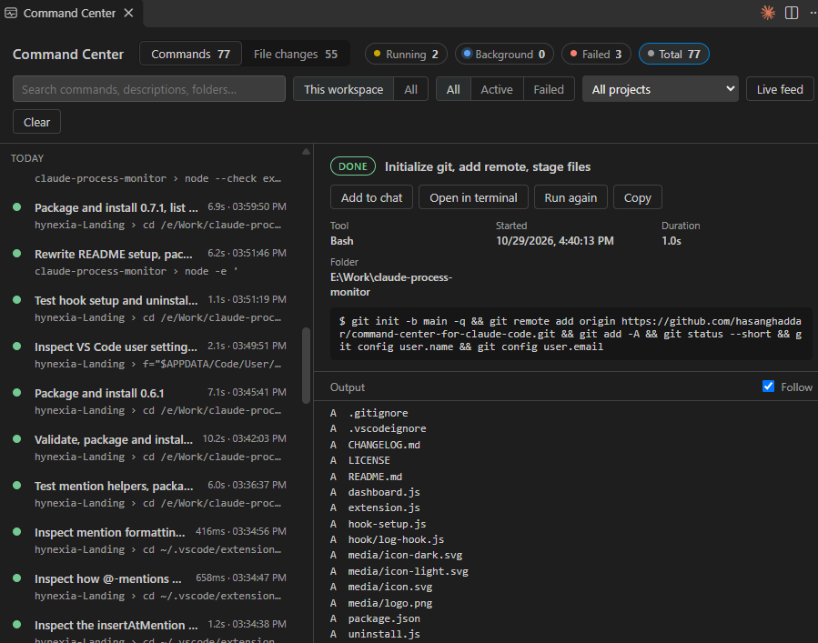
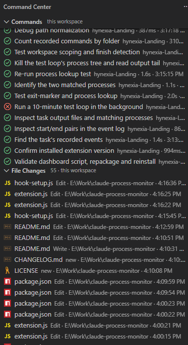

# Command Center for Claude Code

Install from VS Code: open the Extensions view (Ctrl+Shift+X), search **Command Center for Claude Code**, and click **Install**. Or run `code --install-extension hynexia.command-center-for-claude-code`.

One place in VS Code to watch, control and feed context to Claude Code:

- **Watch** every shell command it runs, with its output, and every file it edits, with a diff one click away.
- **Control** background processes such as dev servers: live logs, and a Stop button.
- **Feed context** to the Claude chat: files, folders, editor and terminal selections, command output.
- **Keep track of sessions**: resume them, move them to another project, get notified when Claude finishes or needs you, and see how many tokens you've used.

> **Unofficial.** This extension is made by [Hynexia](https://hynexia.net) and is not affiliated with or endorsed by Anthropic. "Claude" and "Claude Code" are trademarks of Anthropic.

## Features

**Commands**
- A **Command Center** sidebar and a full **dashboard** tab listing every Bash and PowerShell command Claude runs: status, folder, duration, exit code and colored output.
- Click the **Running**, **Background** or **Failed** counts to filter. Search with `/`, move with ↑/↓.
- **Background processes** (dev servers, watchers) stream their output live, open a log tab automatically, and switch to done or failed when they exit.
- **Stop** a background process. It finds the exact process Claude started and stops its whole process tree, after asking you.
- **Dev servers**: when a background process prints a local address (`http://localhost:5173`), you're offered **Open in Browser** or **Open in VS Code**. The address also shows in the list.
- **Run again in my terminal** pastes the command into a real terminal without running it. **Live feed** prints every command as it happens.

**File changes**
- Every file Claude edits or creates, newest first. **Click one to open its diff**: the file just before and just after that edit.
- **Compare with current** diffs the pre-edit version against the file as it is now.

**Sessions**
- A **Sessions** list of your Claude Code conversations in this workspace, with their titles, and which are open or working right now.
- **Open** one in the Claude Code panel, or **Resume in terminal** (`claude --resume`).
- **Move to another project**: Claude Code only lists a session in the folder it started in. Moving it (after you rename or move a project, say) makes it show up and resume in the new folder.
- From any command or file change in the dashboard: **Open session**, or show **only this session**'s commands and edits.
- **View Transcript**: read a session's conversation in a tab: your prompts, Claude's replies and thinking, and each tool call with its result (edits shown as diffs). Search it with match count and ↑/↓, show only matches, hide tool calls or thinking. It follows a running session live.
- **Show in Transcript** on any command or file change jumps to that step of the conversation.
- **Search Sessions…** (search icon in the Sessions view) finds text across all your sessions' prompts, replies and tool calls.
- **Session diff**: every file a session changed in one multi-file diff, from before its first edit to after its last. Or one file across the session.
- **Revert** a whole session's edits, **Claude's last turn**, or **an edit and everything after it** in that session. You pick the files. Any file you've changed since Claude's edit is unticked, so your own work isn't overwritten by accident. The current versions are saved first, and **Undo** puts them back.

**Notifications**
- When Claude **finishes a turn**, or **needs permission or an answer**, in a project open in that window. By default only while the window isn't focused.
- Optionally when a **subagent finishes**, if it ran longer than a minute.

**Answer permission prompts from VS Code** (off by default, `claudeCommandCenter.answerPermissions`)
- For Claude Code running **in a terminal**, permission requests (run this command, edit that file) appear in the VS Code window that has the project open, with **Allow** and **Deny**. Sessions in the Claude Code panel already ask there, so they're left alone.
- There is no "always allow". If you don't answer within 60 seconds (`permissionTimeoutSeconds`), the prompt appears in the terminal as usual. If no window with the project open has this turned on, nothing changes.

**Usage**
- The status bar shows the output tokens Claude Code used on this machine in the last 5 hours. Hover for input, cache and totals for 5 hours, today and 7 days, and a per-model breakdown.

**Add to Claude Chat**
- Right-click files or folders in the Explorer, an editor tab, or selected lines in the editor.
- In a terminal, select text and use the **@** button in the terminal toolbar (or Alt+K) to send the selection. With nothing selected, it sends the last command's output.
- From the dashboard, send a file change (with its edited lines) or a recorded command together with its output.

**Per-workspace**
- Each VS Code window shows only commands and changes inside its own folders. Toggle **All** to see every project.

## Getting started

1. Install the extension from the Marketplace (see above).
2. When it asks **"Set up Command Center for Claude Code?"**, click **Enable**.
3. Start a new Claude Code session. Commands and edits now appear in the **Command Center** sidebar. Open the dashboard from the status bar.

**What setup changes**
- Copies a small logging hook to `~/.claude/command-center/hook/log-hook.js`. It's refreshed on every update.
- Registers it in `~/.claude/settings.json` for Claude Code's `PreToolUse`, `PostToolUse` and `PostToolUseFailure` hooks (commands and edits), `Stop`, `SubagentStart`, `SubagentStop` and `Notification` (for notifications), and `PermissionRequest` (which does nothing unless you turn on answering permission prompts from VS Code). Your other settings and hooks are left alone, and the previous file is saved as `settings.json.bak-command-center`.
- Adds the Alt+K terminal shortcut to `terminal.integrated.commandsToSkipShell` in your VS Code settings.

Run **Command Center: Set Up Hooks** to redo it, or **Command Center: Remove Hooks** to undo it. Uninstalling the extension removes the hooks automatically.

**Requirements**
- VS Code 1.90 or later.
- [Claude Code](https://code.claude.com). Its VS Code extension is needed for **Add to Claude Chat**; without it, mentions are copied to the clipboard instead.
- [Node.js](https://nodejs.org) on your PATH, which the logging hook runs with.

## Privacy

Everything stays on your machine. The extension makes no network requests and sends nothing anywhere.

It reads Claude Code's own session transcripts in `~/.claude/projects` for the Sessions list and token usage, and never changes them, except when you **move** a session.

What gets recorded, in `~/.claude/command-center/log/`:
- **Every command Claude runs, in full, with its output.** If a command contains a token or password, for example a `curl` with an `Authorization` header, it is recorded too.
- **Copies of files before and after each edit** (`snapshots/`), so diffs can be shown. Files over 5 MB are skipped.
- **The first 300 characters of Claude's last message** at the end of each turn and subagent, and the text of permission prompts, to show in notifications.
- **Copies of files you revert**, taken just before the revert so it can be undone (`reverts/`).
- **The text you send with Add to Claude Chat** (`context/`), such as terminal selections, because the chat receives a link to a file rather than the text itself.

How long it is kept:
- Edit snapshots and revert copies: 7 days (`claudeCommandCenter.retentionDays`). A session can only be reverted while its snapshots are kept.
- Chat files: 24 hours (`claudeCommandCenter.chatFileRetentionHours`).
- The command history rotates at 20 MB.
- **Clear History** (the trash icon in the sidebar) deletes all of it at once.

## Settings

| Setting | Default | |
|---|---|---|
| `claudeCommandCenter.scope` | `workspace` | Show only this window's projects, or `all`. |
| `claudeCommandCenter.autoOpenBackground` | `true` | Open a live log tab when Claude starts a background process. |
| `claudeCommandCenter.retentionDays` | `7` | Days to keep edit snapshots. `0` keeps them forever. |
| `claudeCommandCenter.chatFileRetentionHours` | `24` | Hours to keep files made for chat mentions. `0` keeps them forever. |
| `claudeCommandCenter.maxItems` | `200` | Most items shown per list. |
| `claudeCommandCenter.notifyTurnEnd` | `unfocused` | Notify when Claude finishes a turn: `always`, `unfocused` or `never`. |
| `claudeCommandCenter.notifyAttention` | `unfocused` | Notify when Claude needs permission or an answer. |
| `claudeCommandCenter.notifySubagentEnd` | `never` | Notify when a subagent finishes. |
| `claudeCommandCenter.notifySubagentMinSeconds` | `60` | Skip subagents shorter than this. |
| `claudeCommandCenter.answerPermissions` | `false` | Answer terminal sessions' permission prompts from VS Code. |
| `claudeCommandCenter.permissionTimeoutSeconds` | `60` | How long a terminal session waits for that answer before asking in the terminal. |
| `claudeCommandCenter.notifyServerUrl` | `always` | Offer to open a dev server's local address. |
| `claudeCommandCenter.showUsage` | `true` | Show token usage in the status bar. |
| `claudeCommandCenter.sessionDays` | `30` | List sessions active in the last this many days. |
| `claudeCommandCenter.logDir` | | Where the history is read from. Empty means `~/.claude/command-center/log`. |

## Known limitations

- **Foreground output appears when a command finishes**, not while it runs. Claude Code's hooks don't expose output mid-run.
- **Tested on Windows.** macOS and Linux are supported but not yet verified, Stop in particular: it may not find the process there.
- **Files changed by shell commands** (such as `sed` or a script) appear in the command list but get no diff, and can't be reverted.
- **Usage is tokens, not a quota percentage.** Your plan's 5-hour and weekly limits aren't stored locally, so the extension can't show how close you are to them.
- **Open session** uses the Claude Code panel only for sessions in this window's folders; others open in a terminal. A session must be closed before it can be moved, and file paths mentioned earlier in a moved conversation keep their old location.
- **Answering permission prompts**: while VS Code is asking, the terminal shows no prompt; it appears there once the wait runs out. Answer in one place only.
- **Notifications** need the hook from this version: accept the "Update" prompt after upgrading, then start a new Claude Code session.
- **Folders** can't be sent to the Claude chat directly. Their `@folder/` mention is copied to the clipboard for you to paste.

## Troubleshooting

- **Nothing shows up:** check that setup ran (**Command Center: Set Up Hooks**), then start a new Claude Code session. Hooks are read when a session starts.
- **Raw hook data:** create an empty file `~/.claude/command-center/log/debug`, and the hook also writes everything it receives to `~/.claude/command-center/log/raw.jsonl`.

Questions or problems: [open an issue](https://github.com/hasanghaddar/command-center-for-claude-code/issues) or email [info@hynexia.net](mailto:info@hynexia.net).
